<p align="center">
  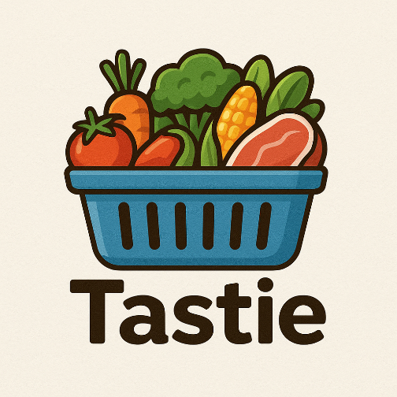
</p>

<h1 align="center">TasTie</h1>

<p align="center">
  <strong>A social recipe app with AI-assisted creation, smart search, and weather-aware discovery.</strong>
</p>

<p align="center">
  <a href="https://drive.google.com/file/d/1TNoPEd6z8iN73cn-cGt0eR3-oV20xJ7L/view?usp=sharing"></a>
  &nbsp;
  
  &nbsp;
  
  &nbsp;
  
</p>

<p align="center">
  <a href="https://drive.google.com/file/d/1TNoPEd6z8iN73cn-cGt0eR3-oV20xJ7L/view?usp=sharing"><strong>↓ Download TasTie.apk (Google Drive)</strong></a>
</p>

---

## Overview

**TasTie** is a Flutter-based social cooking platform built as a Final Year Project. It helps users **discover, create, and share recipes** with a focus on real kitchen needs — what ingredients you have, how many calories you want, and what the weather feels like today.

Beyond a typical feed app, TasTie combines:

- **AI Smart Generate** (Google Gemini via Cloud Functions) to draft recipe title, description, ingredients, procedures, and nutrition from photos / context
- **Ingredient + tag + calorie search** for practical recipe discovery
- **Weather-aware exploration** using live location weather context
- **Community features** — likes, collections, follow, and content reporting
- **Firebase backend** — Auth, Firestore, Storage, and Cloud Functions

---

## Try the App

| | |
|---|---|
| **Platform** | Android |
| **APK** | [Download TasTie.apk](https://drive.google.com/file/d/1TNoPEd6z8iN73cn-cGt0eR3-oV20xJ7L/view?usp=sharing) |
| **Sign-in** | Continue with Google |

> After installing, allow unknown sources if prompted by Android, then sign in with Google to explore the feed and try creating a recipe.

---

## Screenshots

### Welcome & Authentication

| Login | Explore Feed |
|:---:|:---:|
| 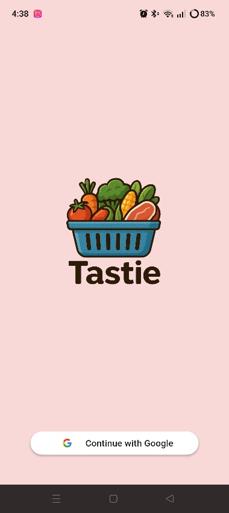 | 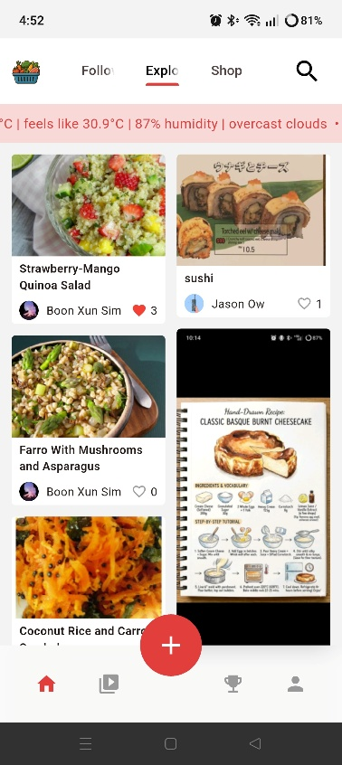 |
| Google Sign-In entry | Weather banner + staggered recipe grid |

### Smart Search & Filters

| Search & Filter | Calorie Filter | Search Results |
|:---:|:---:|:---:|
| 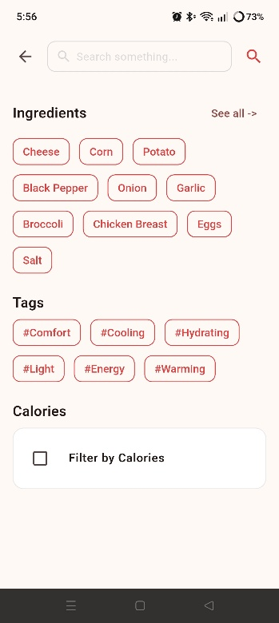 | 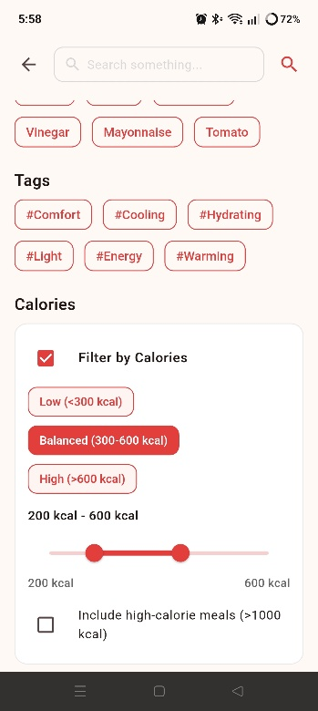 | 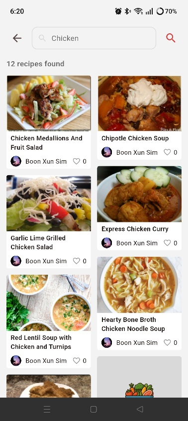 |
| Ingredients & mood tags | Range slider + presets | Keyword / filter results |

### AI-Assisted Recipe Creation

| Post Details | Ingredients | Procedures |
|:---:|:---:|:---:|
| 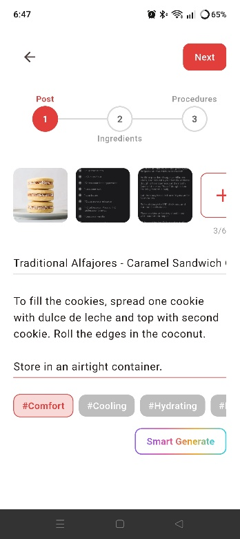 | 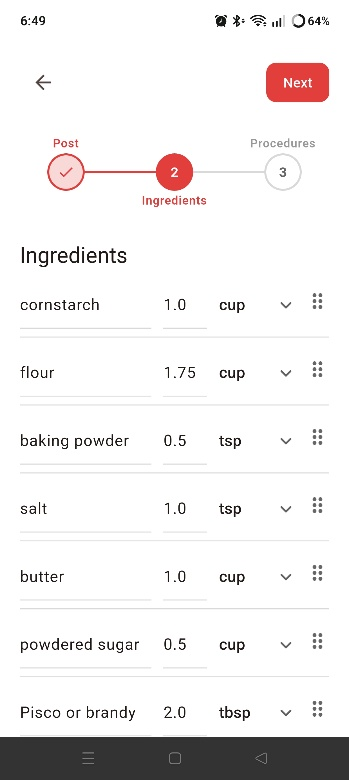 | 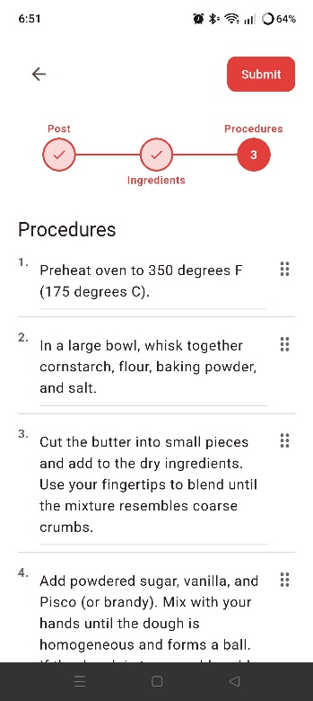 |
| Media, tags & **Smart Generate** | Qty + unit editing | Reorderable cooking steps |

### Recipe Detail & Profile

| Recipe Media | Ingredients & Nutrition | Procedures | Profile |
|:---:|:---:|:---:|:---:|
| 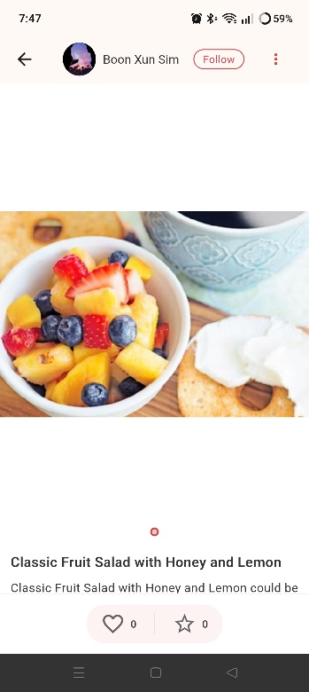 | 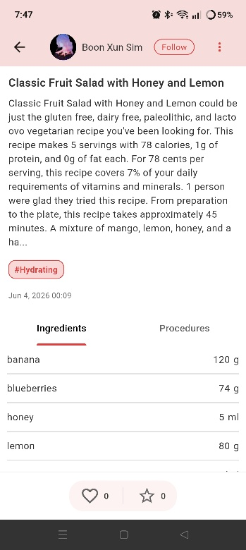 | 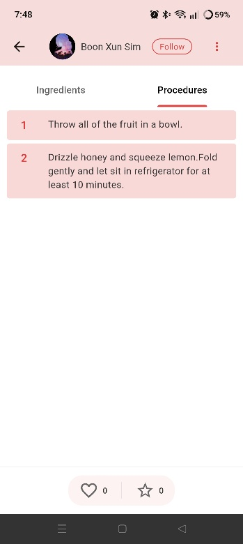 | 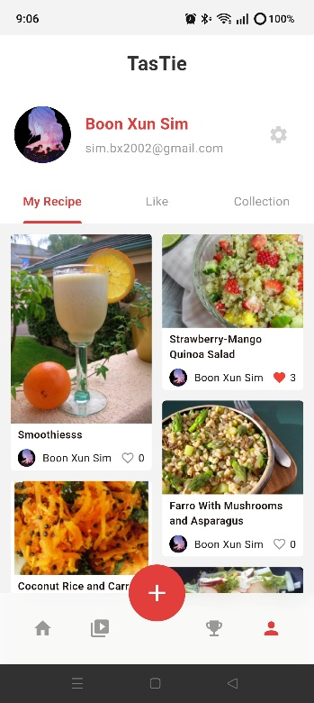 |
| Follow, like & favorite | Structured ingredients | Step-by-step guide | My Recipe / Like / Collection |

### Trust & Safety

| Report Reasons | Submit Report |
|:---:|:---:|
| 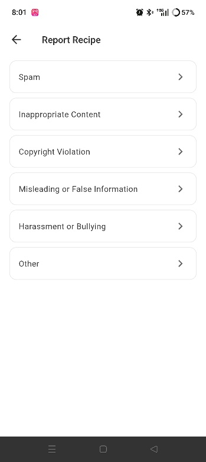 | 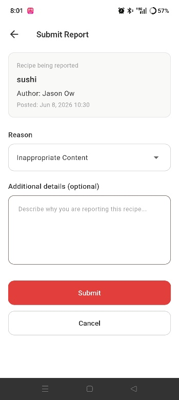 |
| Spam, copyright, harassment… | Reason + optional details |

---

## Key Features

### Discovery
- **Explore feed** with a Pinterest-style staggered grid
- **Weather context banner** (temperature, feels-like, humidity, conditions) to support weather-aware browsing
- **Search** by keyword, ingredients, lifestyle tags (`#Comfort`, `#Hydrating`, `#Energy`, …), and calorie ranges

### Creation
- **3-step publish flow**: Post → Ingredients → Procedures
- Multi-image upload (up to 6), tags, nutrition fields
- **Smart Generate** — multimodal AI assist powered by **Gemini** through Firebase Cloud Functions

### Social & Profile
- Google authentication
- Like, favorite / collection, and follow
- Profile tabs: **My Recipe**, **Like**, **Collection**

### Moderation
- In-app **report recipe** flow with categorized reasons
- Backend support for user status / ban handling and admin metrics

---

## Tech Stack

| Layer | Technology |
|---|---|
| Mobile | Flutter, GetX |
| Auth | Firebase Auth + Google Sign-In |
| Database | Cloud Firestore |
| Storage | Firebase Storage |
| Backend | Firebase Cloud Functions (TypeScript) |
| AI | Google Gemini (`smartGenerate` callable) |
| Weather | OpenWeather via Cloud Functions BFF |
| UI | Custom design system, shimmer loading, cached images, image compression |

---

## Architecture Highlights

```
Flutter App (GetX)
    ├── Firebase Auth / Google Sign-In
    ├── Firestore (users, recipes, tags, reports, …)
    ├── Firebase Storage (recipe media)
    └── Cloud Functions
            ├── smartGenerate      → Gemini multimodal recipe drafting
            ├── getWeatherContext  → OpenWeather BFF
            └── Metrics / moderation triggers
```

- Client stays thin for AI & weather — secrets stay on the server
- Image compression before upload / Smart Generate
- Structured recipe model (ingredients, procedures, nutrition, tags)

---

## Project Structure (high level)

```
tastie/
├── lib/
│   ├── pages/          # Auth, Explore, Search, Create Post, Profile, Report
│   ├── services/       # Smart Generate, recipe create, validators
│   ├── repositories/   # Firestore access
│   ├── models/         # Domain models
│   └── widgets/        # Shared UI (Smart Generate button, etc.)
├── functions/          # Cloud Functions (Gemini, weather, metrics)
└── assets/mediaimg/    # App screenshots used in this README
```

---

## Getting Started (for developers)

```bash
# From the tastie/ app directory
flutter pub get
flutter run
```

Cloud Functions (optional local / deploy):

```bash
cd functions
npm install
# Configure GEMINI_API_KEY / OPENWEATHER_API_KEY per functions docs
firebase deploy --only functions
```

> The public demo path for reviewers is the **APK download** above — no local setup required.

---

## What This Project Demonstrates

As a portfolio piece, TasTie shows end-to-end mobile product skills:

1. **Product thinking** — recipe discovery shaped around ingredients, calories, and weather
2. **Full-stack mobile** — Flutter UI + Firebase Auth / Firestore / Storage / Functions
3. **AI integration** — production-style callable function wrapping Gemini (not a hard-coded API key in the app)
4. **UX craft** — multi-step forms, filters, shimmer states, and consistent visual language
5. **Community readiness** — reporting, moderation hooks, and profile organization

---

## Author

Built by **Boon Xun Sim** as a Final Year Project (FYP).

- **Try the app:** [TasTie.apk on Google Drive](https://drive.google.com/file/d/1TNoPEd6z8iN73cn-cGt0eR3-oV20xJ7L/view?usp=sharing)

---

<p align="center">
  Made with Flutter · Powered by Firebase & Gemini
</p>
